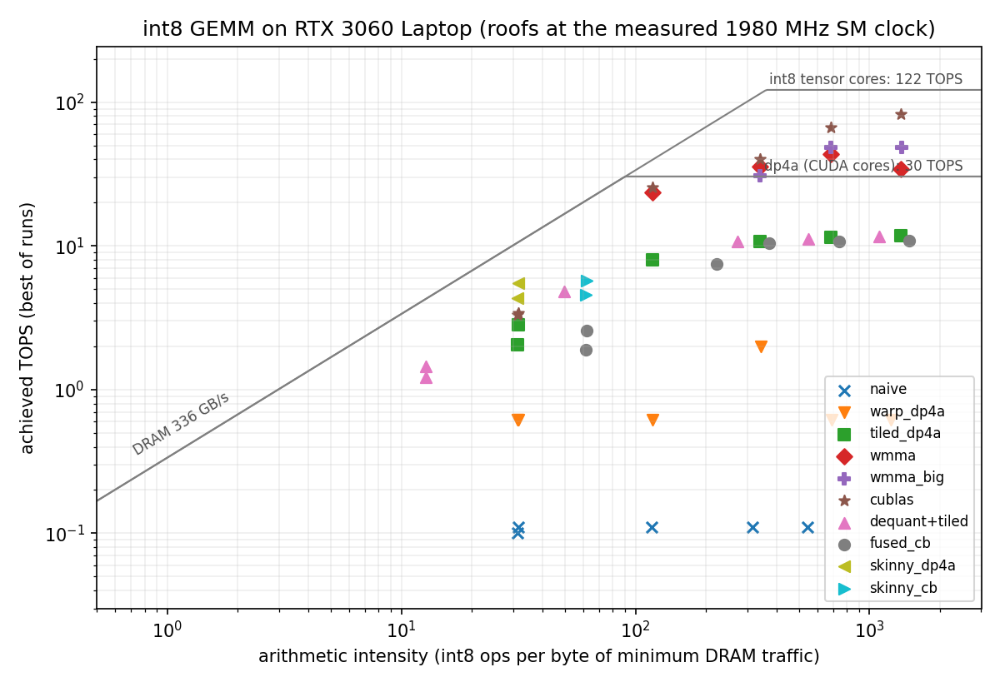

# int8-gemm-cuda

int8 matrix multiply on an RTX 3060 Laptop GPU (GA106, sm_86), from a naive
kernel up to tensor cores. It also includes a kernel for LLM-decode shapes
that reads its weights as 4-bit codebook indices. Every kernel is checked
against a CPU reference on every shape it runs.

`C[M][N] (int32) = A[M][K] (int8) x B[K][N] (int8)`, with B stored
transposed (`Bt[N][K]`, each output column's weights contiguous). That is
the layout dp4a and the tensor cores want, and the same as the
[systolic accelerator](../systolic-accel)'s weight strips.

## Kernels (`src/kernels.cuh`)

| kernel | idea |
|---|---|
| `naive` | one thread per output, byte loads; consecutive threads walk rows, so loads and stores are uncoalesced |
| `warp_dp4a` | one warp per output; lanes split K into 4-byte words (`__dp4a`: 4 multiply-adds), coalesced 128-byte loads, shuffle reduction |
| `tiled_dp4a` | 64x64 block tile in shared memory (rows padded against bank conflicts), 4x4 outputs per thread in registers |
| `wmma` | tensor cores, 16x16x16 int8 fragments, 64x64 block tile |
| `wmma_big` | 128x128 tile (twice the reuse per byte loaded) + `cp.async` double buffering |
| `cublas` | `cublasGemmEx`, `CUBLAS_COMPUTE_32I`, for reference |
| `dequant+tiled` | weights stored as 4-bit indices into 16 int8 levels per column: decode all of B, then `tiled_dp4a` |
| `fused_cb` | the same weights decoded inside `tiled_dp4a`'s shared-memory load |
| `skinny_dp4a` | for M <= 16: one warp per 4 output columns for all rows, streaming B once |
| `skinny_cb` | `skinny_dp4a` reading 4-bit indices; each column's codebook in 4 registers, decoded with two `__byte_perm`s and a select |

## Results

Best of 3 runs, `results/summary.csv`. The SM clock under load was about
1980 MHz (logged in `results/clocks.csv`). At that clock the roofs are
about 122 TOPS for int8 tensor cores, 30 TOPS for dp4a, and 336 GB/s for DRAM.

| shape (M x N x K) | tiled_dp4a | wmma | wmma_big | cuBLAS | skinny_dp4a | skinny_cb |
|---|---|---|---|---|---|---|
| 2048 x 2048 x 2048 | 11.4 TOPS | 43.7 | 48.4 | 66.9 | | |
| 4096 x 4096 x 4096 | 11.7 TOPS | 34.3 | 48.7 | 82.4 | | |
| 16 x 11008 x 4096 (decode) | 0.510 ms | | | 0.426 ms | 0.263 ms | **0.252 ms** |
| 16 x 4096 x 4096 (decode) | 0.264 ms | | | 0.159 ms | 0.129 ms | **0.118 ms** |



What the numbers say:

* **Tensor cores.** `wmma` loses ground from 2048 to 4096 (43.7 to 34.3
  TOPS): with 64x64 tiles each byte loaded is used 64 times, and the warps
  wait on loads. A 128x128 tile with double-buffered `cp.async` holds 48.7
  TOPS at 4096, which is 40% of the tensor-core roof. cuBLAS reaches 82.4
  TOPS (68%). The remaining gap is the usual list: ldmatrix and swizzled
  shared memory, deeper pipelines, larger warp tiles.
* **Decode shapes (M = 16).** Here the tiled kernels waste 3/4 of their
  work on padding rows, and even cuBLAS gets only 3.4 TOPS.
  `skinny_dp4a` streams each weight once and is **1.6x faster than
  cuBLAS** on 16 x 11008 x 4096.
* **Compute for memory.** Storing weights as 4-bit codebook indices halves
  the bytes read from DRAM. But the payoff depends on how the decode is
  done, and on whether the kernel is DRAM-bound at all.
  * Decoding everything first (`dequant+tiled`) is the slowest option:
    about 2x slower than plain int8.
  * Decoding through shared memory (`fused_cb`, and a first version of
    `skinny_cb`) cost more instructions than the halved traffic saved.
  * With the codebook in registers and `__byte_perm` lookups, `skinny_cb`
    is the fastest kernel on both decode shapes, but only by 4-9%:
    `skinny_dp4a` already runs at about 52% of DRAM bandwidth, so halving
    the bytes can't buy much more.

  Bigger wins need a kernel that is truly DRAM-bound (larger N and K,
  fewer instructions per byte).

### Nsight Compute

`profile.ps1` profiles the main kernels into `results/ncu/`. Windows lets
only administrators read the GPU performance counters (ERR_NVGPUCTRPERM),
so it has to run elevated. That is why the roofline above uses the
minimum possible DRAM traffic rather than measured traffic.

## Build and run

Needs CUDA 13.x and the Visual Studio 2026 C++ tools.

```bat
build.bat                 :: -> build\gemm.exe (nvcc -O3 -arch=sm_86)
build\gemm.exe            :: correctness on 7 shapes, then benchmarks (CSV)
python bench.py 3         :: 3 runs + clock log -> results\summary.csv, roofline.png
```

`build\gemm.exe --kernel NAME M N K` runs one kernel (for profiling).

## How this was built

The code was written with Claude Code (Anthropic's AI coding agent) under
Rayan Benaoussar's direction: Rayan chose what to build, what to measure and
which trade-offs to take; Claude wrote the code and ran the tools. Every
number here comes from a script or log in this folder.
